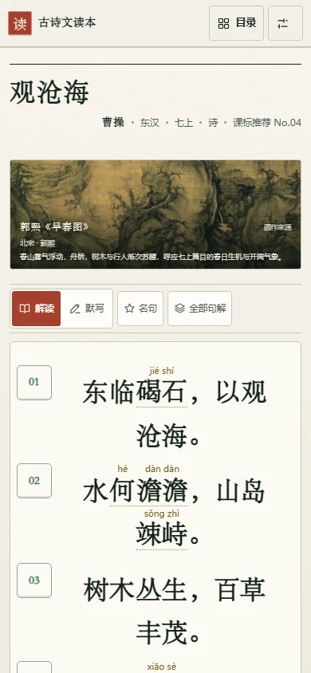
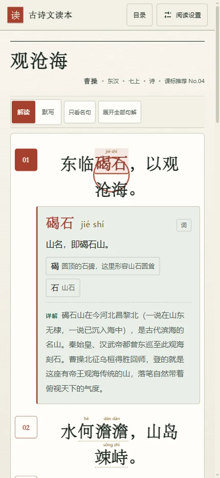

<p align="center">
  
</p>

<h1 id="zh" align="center">古诗文读本</h1>

<p align="center">
  <a href="#zh">中文</a> · <a href="#en">English</a><br>
  广东中考 · 初中必背古诗文 · 逐字逐词完全解读<br>
  <a href="https://gushiwen-reader-x7alhjqexlp.qoder.zone">公网预览</a>
  ·
  <a href="https://github.com/YardonYan/gushiwen-reader">GitHub 仓库</a>
</p>

<p align="center">
  
  
  
</p>

一个面向学生自学、教师备课和课堂投屏的古诗文读本。每篇作品独占一页，原文可以逐字逐词点击，疑难字显示拼音，整句可以展开释义与译文，并配有全文翻译、整体理解和考点辨误。

## 界面预览

| 篇目目录 | 单篇解读 |
| :---: | :---: |
|  |  |

| 移动端目录 | 移动端阅读 |
| :---: | :---: |
|  |  |

## 项目背景

灵感来自日常学习中的三个问题：必背篇目分散、疑难字缺少读音、译文与原文对不上。读本把《义务教育语文课程标准（2022年版）》7—9 年级推荐篇目、统编教材篇目和广东卷考查记录放在同一套目录中，按年级与体裁编排。

目前收录 **105 篇**，其中诗 56 篇、词 18 篇、曲 4 篇、文 27 篇。

| 分类 | 数量 | 说明 |
| :--- | ---: | :--- |
| 课标推荐 | 62 | 依据 2022 年版课标 7—9 年级推荐篇目整理 |
| 教材增补 | 43 | 补齐统编教材要求掌握的作品 |
| 广东卷考过 | 18 | 单独标记实际年份与题型，与上述两类交叉 |

“广东卷考过”不是频率估算。标签直接来自目录中记录的考查年份和题型，例如“2025 理解性默写”“2023 情境化默写”。

## 主要功能

- **逐字逐词释义**：点击原文中的字或词，打开注音、字义、详解和易错提醒。
- **整句解读**：点击句号，查看整句释义、译文和赏析。
- **全文翻译与整体理解**：帮助学生从字词进入篇章，也方便教师备课。
- **背诵默写**：支持隐藏提示、逐空输入、错字标记、显示答案、重置和完成印章。
- **原文搜索**：可按篇名、作者、朝代或任意一句诗文搜索。
- **组合筛选**：按年级、体裁、课标推荐、教材增补和广东卷考查筛选。
- **阅读设置**：拼音有关闭、难字、全部三档；字号有五档；墨夜与宣纸主题可切换并本地保存。
- **课堂投屏**：大字号自适应，正文和释义保持清晰，无需单独进入投影模式。
- **移动端适配**：320—1440px 宽度下均无横向溢出，主要控件保持 44×44px 可点击尺寸。

## 阅读示例

点击《观沧海》中的“碣石”，可以看到 `jié shí` 的读音、词义、字形解释，以及碣石山与曹操北征乌桓的背景。

<p align="center">
  
</p>

句首编号用于展开整句释义。例如“树木丛生，百草丰茂”会显示“岛上树木繁茂，百草丰美”，并说明秋景中草木繁盛与诗人昂扬心境的关系。

## 视觉设计

整体采用“宋画长卷 + 博物馆展签”的方向：

- 目录是分年级的展品索引，不是等权卡片墙。
- 单篇阅读以山水配图、篇名、作者与原文构成展签。
- 墨夜主题偏向夜间展厅与古籍阅读。
- 宣纸主题偏向日间展厅与纸本长卷。
- 两套主题分别处理色彩、字体、边框与画面，不是简单换色。

画作使用范宽《溪山行旅图》、郭熙《早春图》和王希孟《千里江山图》，均为公有领域作品，图片已本地压缩，不依赖外部图片服务。

## 本地运行

需要 Node.js 18 或更高版本。项目没有第三方依赖，不需要安装包。

```bash
git clone https://github.com/YardonYan/gushiwen-reader.git
cd gushiwen-reader
npm start
```

打开终端输出的地址，默认是：

```text
http://127.0.0.1:4173
```

如需修改端口：

```bash
PORT=8080 npm start
```

## 静态部署

`web/` 就是完整静态站点，可以直接部署到 GitHub Pages、Netlify、Vercel、Cloudflare Pages 或任意静态服务器。

- 入口文件：`web/index.html`
- 路由使用 URL Hash，不需要配置 SPA 重写。
- 运行时的样式、脚本、诗文数据和图片全部位于 `web/` 内。
- 页脚仅保留画作来源链接，不请求外部 API。

## 目录结构

```text
.
├─ web/
│  ├─ index.html
│  ├─ assets/
│  │  ├─ css/
│  │  │  ├─ site.css
│  │  │  └─ curation.css
│  │  ├─ js/
│  │  │  ├─ app.js
│  │  │  ├─ reader.js
│  │  │  ├─ dictation.js
│  │  │  └─ motif.js
│  │  └─ images/
│  └─ data/
│     ├─ catalog.json
│     ├─ source.json
│     └─ pieces/
├─ docs/
│  └─ images/
├─ scripts/
│  └─ serve.mjs
├─ LICENSE
├─ package.json
└─ README.md
```

## 数据说明

- `catalog.json`：目录、年级、体裁、课标或教材分类、广东卷考查记录。
- `source.json`：原文底本，用于全文搜索与完整性校验。
- `pieces/<id>.json`：单篇的作者介绍、创作背景、逐词解释、句子翻译、全文翻译、整体理解和考点。

原文有明确的一致性约束：把 `lines[].t[].w` 依次拼接并移除空白后，必须与 `source.json` 对应文本完全一致，包括标点。当前 105 篇均已通过该校验。

## 技术特点

- 原生 HTML、CSS 和 ES Modules，无框架、无构建步骤。
- Hash 路由：`#/` 为目录，`#/p/<id>` 为单篇。
- 异步搜索与路由切换带版本检查，避免旧请求覆盖新结果。
- 设置保存在浏览器 `localStorage`，不需要账号或后端。
- 支持减少动态效果的系统偏好与打印样式。

## 开发方式

本项目由 Qoder AI Coding 助手协作完成，涵盖篇目资料整理、内容编写、前端实现、静态校验与浏览器回归。项目本身不调用 AI 服务，不需要模型、API Key 或后端；使用者直接读取仓库中的诗文数据和解读内容。

---

<h1 id="en" align="center">Classical Chinese Reader</h1>

<p align="center">
  <a href="#zh">中文</a> · English<br>
  Guangdong Zhongkao · Junior High Required Reading · Word-by-Word Notes<br>
  <a href="https://gushiwen-reader-x7alhjqexlp.qoder.zone">Live Preview</a>
  ·
  <a href="https://github.com/YardonYan/gushiwen-reader">GitHub Repository</a>
</p>

<p align="center">
  
  
  
</p>

A classical Chinese reading companion for students, teachers, and classroom projection. Every work has its own page. Readers can click individual characters and words for pinyin and explanations, expand sentences for translations and analysis, and study the complete translation, overall interpretation, and exam notes.

## Interface Preview

| Catalog | Work Reader |
| :---: | :---: |
|  |  |

| Mobile Catalog | Mobile Reader |
| :---: | :---: |
|  |  |

## Background

The project started with three everyday study problems: required reading is scattered across sources, difficult characters often lack pinyin, and translations can be hard to match back to the original text. This reader brings together the recommended Grade 7–9 texts from the 2022 compulsory education Chinese curriculum standards, unified textbook works, and recorded Guangdong examination questions in one catalog, organized by grade and genre.

The collection currently contains **105 works**: 56 poems, 18 ci lyrics, 4 qu pieces, and 27 prose works.

| Category | Count | Description |
| :--- | ---: | :--- |
| Curriculum-recommended | 62 | Recommended Grade 7–9 works from the 2022 curriculum standards |
| Textbook additions | 43 | Additional works required by the unified Chinese textbooks |
| Appeared in Guangdong exams | 18 | Actual year and question type, overlapping the categories above |

“Appeared in Guangdong exams” is not an estimated frequency. Each label comes from a recorded examination year and question type, such as “2025 comprehension dictation” or “2023 contextual dictation.”

## Features

- **Character and word notes**: Click a character or word in the original text to see pinyin, meaning, detailed explanation, and common mistakes.
- **Sentence explanations**: Click a sentence number to expand its meaning, translation, and appreciation notes.
- **Complete translation and interpretation**: Move from individual words to the full passage for independent study or lesson preparation.
- **Dictation practice**: Hide hints, enter answers blank by blank, review mistakes, reveal answers, reset, and earn a completion stamp.
- **Full-text search**: Search by title, author, dynasty, or any line of poetry or prose.
- **Combined filters**: Filter by grade, genre, curriculum recommendation, textbook addition, and Guangdong examination record.
- **Reading preferences**: Three pinyin modes, five type sizes, and independently designed dark and paper themes, saved locally.
- **Classroom projection**: Adaptive large text keeps the original work and explanations readable without a separate projection mode.
- **Responsive layout**: No horizontal overflow from 320–1440px, with primary controls kept at least 44×44px.

## Reading Example

Click “碣石” in *Viewing the Sea* (《观沧海》) to see the pronunciation `jié shí`, the meaning of the place name, character notes, and the historical background of Cao Cao’s northern campaign against the Wuhuan.

<p align="center">
  
</p>

Sentence numbers expand the explanation. For example, “树木丛生，百草丰茂” is explained as luxuriant trees and grass on the island, with notes connecting the autumn landscape to the poet’s vigorous mood.

## Visual Design

The visual direction combines a Song-dynasty landscape scroll with museum exhibit labels:

- The catalog is a grade-based exhibit index rather than a wall of equally weighted cards.
- Each reader page uses a landscape, title, author, and original text as its exhibit label.
- The dark theme suggests a night gallery and old-book reading.
- The paper theme suggests a daytime gallery and a paper scroll.
- The two themes have separate palettes, typography, borders, and image treatments rather than simple color swaps.

The artwork includes *Travelers Among Mountains and Streams* by Fan Kuan, *Early Spring* by Guo Xi, and *A Thousand Li of Rivers and Mountains* by Wang Ximeng. All are public-domain works, stored locally as compressed WebP images without an external image service.

## Run Locally

Node.js 18 or later is required. There are no third-party dependencies and no package installation step.

```bash
git clone https://github.com/YardonYan/gushiwen-reader.git
cd gushiwen-reader
npm start
```

Open the address printed by the server. The default is:

```text
http://127.0.0.1:4173
```

To use another port:

```bash
PORT=8080 npm start
```

## Static Deployment

The `web/` directory is the complete static site. It can be deployed directly to GitHub Pages, Netlify, Vercel, Cloudflare Pages, or any static server.

- Entry file: `web/index.html`
- Hash routing requires no SPA rewrite rules.
- All runtime styles, scripts, text data, and images are inside `web/`.
- The footer only links to artwork sources; it does not request an external API.

## Project Structure

```text
.
├─ web/
│  ├─ index.html
│  ├─ assets/
│  │  ├─ css/
│  │  │  ├─ site.css
│  │  │  └─ curation.css
│  │  ├─ js/
│  │  │  ├─ app.js
│  │  │  ├─ reader.js
│  │  │  ├─ dictation.js
│  │  │  └─ motif.js
│  │  └─ images/
│  └─ data/
│     ├─ catalog.json
│     ├─ source.json
│     └─ pieces/
├─ docs/
│  └─ images/
├─ scripts/
│  └─ serve.mjs
├─ LICENSE
├─ package.json
└─ README.md
```

## Data Notes

- `catalog.json`: Catalog metadata, grades, genres, source classifications, and Guangdong examination records.
- `source.json`: Source texts used for full-text search and integrity checks.
- `pieces/<id>.json`: Author biography, background, word notes, sentence translations, complete translation, overall interpretation, and exam points for each work.

Every piece follows a strict text-integrity rule: concatenate all `lines[].t[].w` values in order, remove whitespace, and the result must exactly match the corresponding text in `source.json`, including punctuation. All 105 works pass this check.

## Technical Details

- Native HTML, CSS, and ES Modules; no framework or build step.
- Hash routes: `#/` for the catalog and `#/p/<id>` for an individual work.
- Version checks prevent stale asynchronous search or route responses from replacing newer results.
- Preferences are stored in browser `localStorage`; no account or backend is required.
- Reduced-motion preferences and print styles are supported.

## AI-Assisted Development

The project was developed with the Qoder AI Coding assistant, including source organization, content drafting, frontend implementation, static validation, and browser regression testing. The published reader itself does not call an AI service and requires no model, API key, or backend: visitors read the text data and explanations stored in the repository.

---

## 版权说明 / Copyright

本项目中的诗歌、文言文原文、教材编排及相关内容并非本项目作者所有，相关权利归原作者或相应权利人所有。作者仅出于学习和交流态度制作本站，内容仅供学习及教师课程讲解、投影演示使用，不主张内容版权。

The poetry, prose, textbook arrangements, and related content in this project are not owned by the project author. Relevant rights belong to the original authors or other rightsholders. The author created this site solely for learning and exchange. The content is intended for study, classroom explanation by teachers, and projection demonstrations; no copyright is claimed over the content.

The repository’s original code, README, and visual arrangement use the [MIT License](LICENSE). The classical texts and public-domain paintings do not acquire new rights claims through this license.

画作来源 / Artwork sources:

- [范宽《溪山行旅图》 / Fan Kuan, Travelers Among Mountains and Streams](https://commons.wikimedia.org/wiki/File:Fan_Kuan_-_Travelers_Among_Mountains_and_Streams_-_Google_Art_Project.jpg)
- [郭熙《早春图》 / Guo Xi, Early Spring](https://commons.wikimedia.org/wiki/File:Guo_Xi_-_Early_Spring_(large).jpg)
- [王希孟《千里江山图》 / Wang Ximeng, A Thousand Li of Rivers and Mountains](https://commons.wikimedia.org/wiki/File:Wang_Ximeng._A_Thousand_Li_of_Rivers_and_Mountains._(Complete,_51,3x1191,5_cm)._1113._Palace_museum,_Beijing.jpg)
