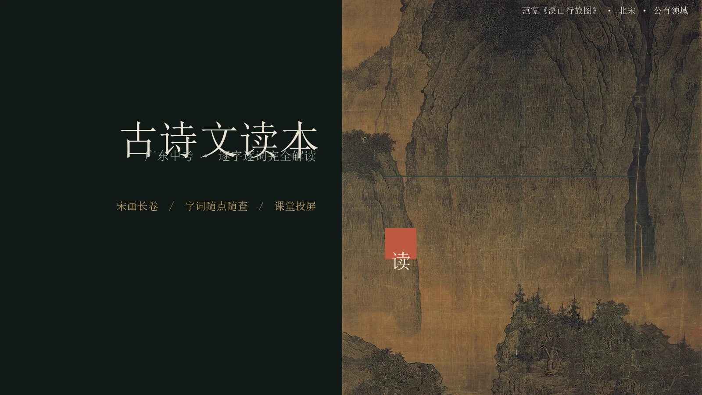
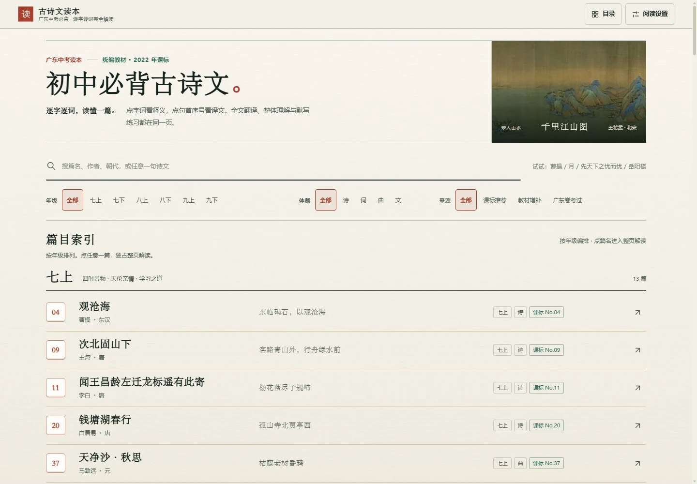
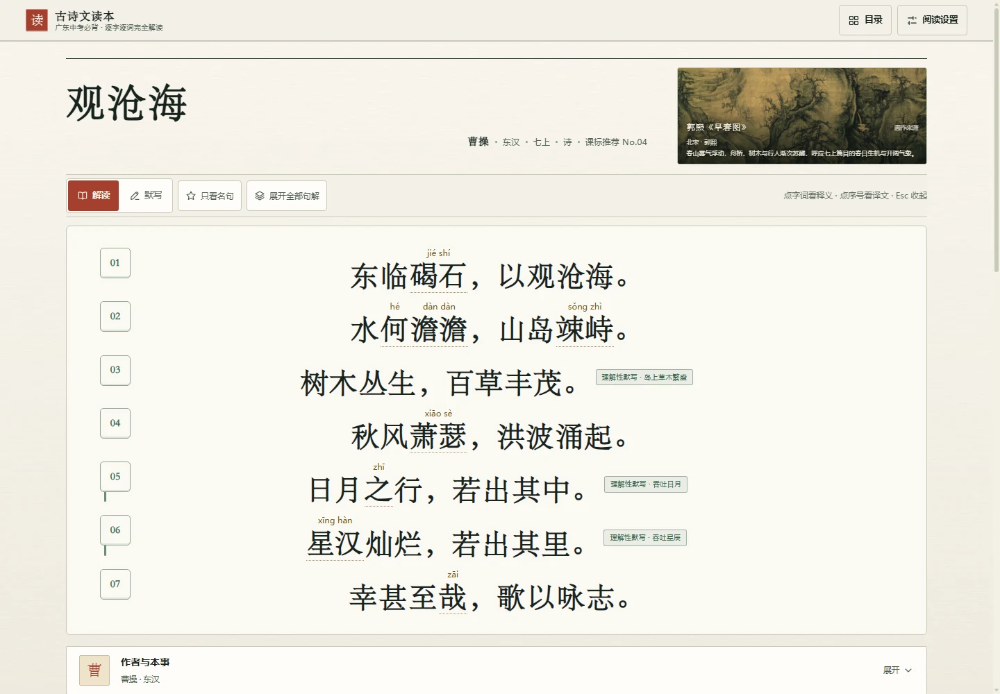

<p align="center">
  
</p>

<h1 align="center">古诗文读本</h1>

<p align="center">
  广东中考 · 初中必背古诗文 · 逐字逐词完全解读<br>
  <a href="https://gushiwen-reader-x7alhjqexlp.qoder.zone">公网预览</a>
  ·
  <a href="https://github.com/YardonYan/gushiwen-reader">GitHub 仓库</a>
</p>

<p align="center">
  
  
  
</p>

一个面向学生自学、教师备课和课堂投屏的古诗文读本。每篇作品独占一页，原文可以逐字逐词点击，疑难字显示拼音，整句可以展开释义与译文，并配有全文翻译、整体理解和考点辨误。

## 界面预览

| 篇目目录 | 单篇解读 |
| :---: | :---: |
|  |  |

| 移动端目录 | 移动端阅读 |
| :---: | :---: |
|  |  |

## 项目背景

灵感来自日常学习中的三个问题：必背篇目分散、疑难字缺少读音、译文与原文对不上。读本把《义务教育语文课程标准（2022年版）》7—9 年级推荐篇目、统编教材篇目和广东卷考查记录放在同一套目录中，按年级与体裁编排。

目前收录 **105 篇**，其中诗 56 篇、词 18 篇、曲 4 篇、文 27 篇。

| 分类 | 数量 | 说明 |
| :--- | ---: | :--- |
| 课标推荐 | 62 | 依据 2022 年版课标 7—9 年级推荐篇目整理 |
| 教材增补 | 43 | 补齐统编教材要求掌握的作品 |
| 广东卷考过 | 18 | 单独标记实际年份与题型，与上述两类交叉 |

“广东卷考过”不是频率估算。标签直接来自目录中记录的考查年份和题型，例如“2025 理解性默写”“2023 情境化默写”。

## 主要功能

- **逐字逐词释义**：点击原文中的字或词，打开注音、字义、详解和易错提醒。
- **整句解读**：点击句号，查看整句释义、译文和赏析。
- **全文翻译与整体理解**：帮助学生从字词进入篇章，也方便教师备课。
- **背诵默写**：支持隐藏提示、逐空输入、错字标记、显示答案、重置和完成印章。
- **原文搜索**：可按篇名、作者、朝代或任意一句诗文搜索。
- **组合筛选**：按年级、体裁、课标推荐、教材增补和广东卷考查筛选。
- **阅读设置**：拼音有关闭、难字、全部三档；字号有五档；墨夜与宣纸主题可切换并本地保存。
- **课堂投屏**：大字号自适应，正文和释义保持清晰，无需单独进入投影模式。
- **移动端适配**：320—1440px 宽度下均无横向溢出，主要控件保持 44×44px 可点击尺寸。

## 阅读示例

点击《观沧海》中的“碣石”，可以看到 `jié shí` 的读音、词义、字形解释，以及碣石山与曹操北征乌桓的背景。

<p align="center">
  
</p>

句首编号用于展开整句释义。例如“树木丛生，百草丰茂”会显示“岛上树木繁茂，百草丰美”，并说明秋景中草木繁盛与诗人昂扬心境的关系。

## 视觉设计

整体采用“宋画长卷 + 博物馆展签”的方向：

- 目录是分年级的展品索引，不是等权卡片墙。
- 单篇阅读以山水配图、篇名、作者与原文构成展签。
- 墨夜主题偏向夜间展厅与古籍阅读。
- 宣纸主题偏向日间展厅与纸本长卷。
- 两套主题分别处理色彩、字体、边框与画面，不是简单换色。

画作使用范宽《溪山行旅图》、郭熙《早春图》和王希孟《千里江山图》，均为公有领域作品，图片已本地压缩，不依赖外部图片服务。

## 本地运行

需要 Node.js 18 或更高版本。项目没有第三方依赖，不需要安装包。

```bash
git clone https://github.com/YardonYan/gushiwen-reader.git
cd gushiwen-reader
npm start
```

打开终端输出的地址，默认是：

```text
http://127.0.0.1:4173
```

如需修改端口：

```bash
PORT=8080 npm start
```

## 静态部署

`web/` 就是完整静态站点，可以直接部署到 GitHub Pages、Netlify、Vercel、Cloudflare Pages 或任意静态服务器。

- 入口文件：`web/index.html`
- 路由使用 URL Hash，不需要配置 SPA 重写。
- 运行时的样式、脚本、诗文数据和图片全部位于 `web/` 内。
- 页脚仅保留画作来源链接，不请求外部 API。

## 目录结构

```text
.
├─ web/
│  ├─ index.html
│  ├─ assets/
│  │  ├─ css/
│  │  │  ├─ site.css
│  │  │  └─ curation.css
│  │  ├─ js/
│  │  │  ├─ app.js
│  │  │  ├─ reader.js
│  │  │  ├─ dictation.js
│  │  │  └─ motif.js
│  │  └─ images/
│  └─ data/
│     ├─ catalog.json
│     ├─ source.json
│     └─ pieces/
├─ docs/
│  └─ images/
├─ scripts/
│  └─ serve.mjs
├─ LICENSE
├─ package.json
└─ README.md
```

## 数据说明

- `catalog.json`：目录、年级、体裁、课标或教材分类、广东卷考查记录。
- `source.json`：原文底本，用于全文搜索与完整性校验。
- `pieces/<id>.json`：单篇的作者介绍、创作背景、逐词解释、句子翻译、全文翻译、整体理解和考点。

原文有明确的一致性约束：把 `lines[].t[].w` 依次拼接并移除空白后，必须与 `source.json` 对应文本完全一致，包括标点。当前 105 篇均已通过该校验。

## 技术特点

- 原生 HTML、CSS 和 ES Modules，无框架、无构建步骤。
- Hash 路由：`#/` 为目录，`#/p/<id>` 为单篇。
- 异步搜索与路由切换带版本检查，避免旧请求覆盖新结果。
- 设置保存在浏览器 `localStorage`，不需要账号或后端。
- 支持减少动态效果的系统偏好与打印样式。

## 开发方式

本项目由 Qoder AI Coding 助手协作完成，涵盖篇目资料整理、内容编写、前端实现、静态校验与浏览器回归。项目本身不调用 AI 服务，不需要模型、API Key 或后端；使用者直接读取仓库中的诗文数据和解读内容。

## 版权说明

本项目中的诗歌、文言文原文、教材编排及相关内容并非本项目作者所有，相关权利归原作者或相应权利人所有。作者仅出于学习和交流态度制作本站，内容仅供学习及教师课程讲解、投影演示使用，不主张内容版权。

仓库中的原创代码、README 与视觉编排采用 [MIT License](LICENSE)。古诗文原文与公有领域画作不因该许可证产生新的权利主张。

画作来源：

- [范宽《溪山行旅图》](https://commons.wikimedia.org/wiki/File:Fan_Kuan_-_Travelers_Among_Mountains_and_Streams_-_Google_Art_Project.jpg)
- [郭熙《早春图》](https://commons.wikimedia.org/wiki/File:Guo_Xi_-_Early_Spring_(large).jpg)
- [王希孟《千里江山图》](https://commons.wikimedia.org/wiki/File:Wang_Ximeng._A_Thousand_Li_of_Rivers_and_Mountains._(Complete,_51,3x1191,5_cm)._1113._Palace_museum,_Beijing.jpg)
